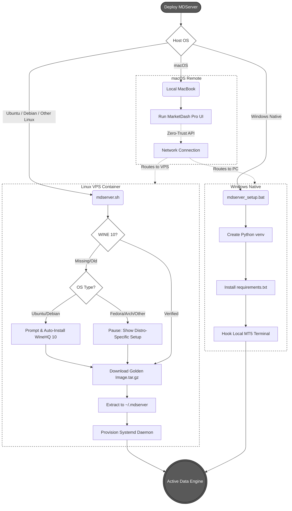

# MDServer Engineering: Architecture, Build & Deployment Guide

This document tracks the internal procedures for building the MT5 WINE container, the cross-platform deployment architecture, and the Linux distribution mechanics.

## 1. Cross-Platform Deployment Architecture



MDServer is designed to function as a standalone data engine or a MarketDash Pro backend. Deployment strategies vary strictly by OS:

*   **Linux (Ubuntu/Debian & Other Distros):** Deployed via a pre-compiled Golden Image (.tar.gz). A wrapper script (mdserver.sh) handles WINE 10 validation. If WINE 10 is missing on Ubuntu/Debian, the script automatically installs it after user approval. For other distros (Fedora, Arch, RHEL), it detects the OS, provides exact instructions for their package manager, and pauses. It then handles extraction and Systemd daemonization for 24/7 VPS uptime.
*   **Windows**: Native deployment. WSL is explicitly avoided to prevent nested emulation latency. Users run a lightweight script to create a Python `venv` and connect directly to their locally installed MT5 terminal.
*   **macOS**: Remote VPS required. Apple's native WINE/CrossOver implementations cannot safely bridge a Windows Python interpreter to the MT5 memory space. Mac users must run the frontend UI locally and connect to an MDServer instance hosted on a Linux/Windows VPS via Zero-Trust API keys. This ensures algorithmic trading stability (avoiding laptop sleep states and network drops).

## 2. Golden Image Generation

The Linux architecture relies on an **Offline Deterministic Build** to bypass MetaQuotes' aggressive WinLicense/Themida anti-cheat heuristics and prevent silent web-installer corruption.

*   **Base Source**: Known-good MT5 binaries copied directly from a working prefix, avoiding `mt5setup.exe` web payloads.
*   **Python Bridge**: Python 3.10.11 injected silently into the WINE prefix, bound with `MetaTrader5`, `fastapi`, and `uvicorn`.
*   **Nuclear Update Block**: MT5 `WebInstall` directory destroyed and replaced with a locked, read-only dummy file (`chmod 444`) to force background updaters to fail instantly.
*   **Capture**: Compressed to ~2GB via maximum GZIP efficiency.

## 3. Golden Image Specifications (v1.0.3)

*   **File Size**: ~2GB (Compressed)
*   **Emulation Target**: WINE 10 (Configured for Windows 10 compatibility)
*   **MetaTrader 5 Version**: 5.0.6231 (Locked and update-immune)
*   **Python Runtime**: 3.10.11 (amd64)
*   **Core Dependencies**: `MetaTrader5`, `fastapi`, `uvicorn`, `pydantic`, `pydantic-settings`, `numpy==1.24.3`, `cachetools`, `python-dotenv`, `tzdata`

## 4. The Build Script (Source of Truth)

This is the exact atomic script used to generate the version-locked image. Execute this natively on an Ubuntu machine holding a working `~/.mt5` prefix to generate future images.

```bash
#!/bin/bash
# build_pristine_env.sh (Offline Deterministic Build + Nuclear Update Block)

SOURCE_MT5="$HOME/.mt5/drive_c/Program Files/MetaTrader 5"
PREFIX_PATH="$HOME/.mdserver_pristine_3"
export WINEPREFIX="$PREFIX_PATH"

echo "🔍 1. Verifying Source Files..."
if [ ! -d "$SOURCE_MT5" ]; then
    echo "❌ Error: Could not find MT5 binaries at $SOURCE_MT5"
    exit 1
fi

echo "🧹 2. Wiping target prefix ($PREFIX_PATH)..."
wineserver -k 2>/dev/null || true
rm -rf "$WINEPREFIX"

echo "⚙️ 3. Initializing Fresh WINE (Windows 10 mode)..."
winecfg -v win10
wineboot -u

echo "⬇️ 4. Downloading Python Installer..."
wget -nc -O python-installer.exe "[https://www.python.org/ftp/python/3.10.11/python-3.10.11-amd64.exe](https://www.python.org/ftp/python/3.10.11/python-3.10.11-amd64.exe)"

echo "🐍 5. Installing Python 3.10 (Silent)..."
wine python-installer.exe /quiet InstallAllUsers=1 PrependPath=1 Include_test=0
wineserver -w

echo "📦 6. Injecting Sterile MT5 Binaries..."
mkdir -p "$WINEPREFIX/drive_c/Program Files/MetaTrader 5"
cp -r "$SOURCE_MT5/"* "$WINEPREFIX/drive_c/Program Files/MetaTrader 5/"

echo "🛡️ 7. Applying MT5 Nuclear Update Block..."
UPDATE_BASE="$WINEPREFIX/drive_c/users/$USER/AppData/Roaming/MetaQuotes"
mkdir -p "$UPDATE_BASE"
rm -rf "$UPDATE_BASE/WebInstall"
touch "$UPDATE_BASE/WebInstall"
chmod 444 "$UPDATE_BASE/WebInstall"

echo "👀 8. Clean Launch for Verification..."
wine "C:\Program Files\MetaTrader 5\terminal64.exe"
read -p "Press [ENTER] ONLY AFTER you have closed the MT5 window..."
wineserver -k 2>/dev/null || true

echo "🐍 9. Installing Python dependencies..."
wine python -m pip install --upgrade pip setuptools
wine python -m pip install fastapi uvicorn MetaTrader5 pydantic cachetools pydantic-settings python-dotenv tzdata "numpy==1.24.3"
wineserver -w

echo "🧹 10. Cleaning up..."
rm -f python-installer.exe

```

## 5. Linux Deployment: The Global CLI (`mdserver`)

The user-facing deployment mechanism is a global bash CLI tool (`/usr/local/bin/mdserver`) that executes a strict state machine to provision and manage the environment.

### Command Routings:
*   `mdserver install`: 
    *   Validates/Installs strictly version-locked WINE 10 (Ubuntu/Debian/Fedora).
    *   Fetches and extracts the 2GB Golden Image (`mdserver_base.tar.gz`) to `~/.mdserver`.
    *   Clones the active API repository to `~/.mdserver/app`.
    *   Generates the `mdserver.service` Systemd daemon (which includes native overrides for `Xvfb` headless routing).
*   `mdserver update`: 
    *   Executes `git pull` in the `app` directory.
    *   Updates Python dependencies (`pip install -r requirements.txt`).
    *   Gracefully restarts the Systemd service.
*   `mdserver status`: Queries the Systemd daemon uptime and checks for zombie MT5 processes.
*   `mdserver version`: Outputs the Golden Image version and the Git commit hash.

### SSH Update Notifications
The architecture includes a daily cron/timer that pings the GitHub API for new releases. If a new version is detected, it writes a flag triggering a standard `.bashrc` MOTD payload, notifying users upon SSH login: `🔔 MDServer Application Update Available. Run 'mdserver update'.`


