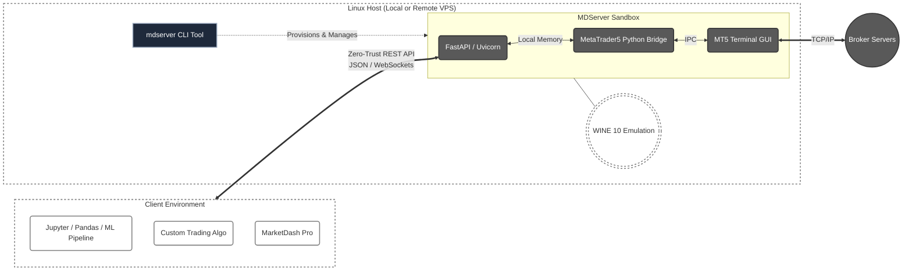
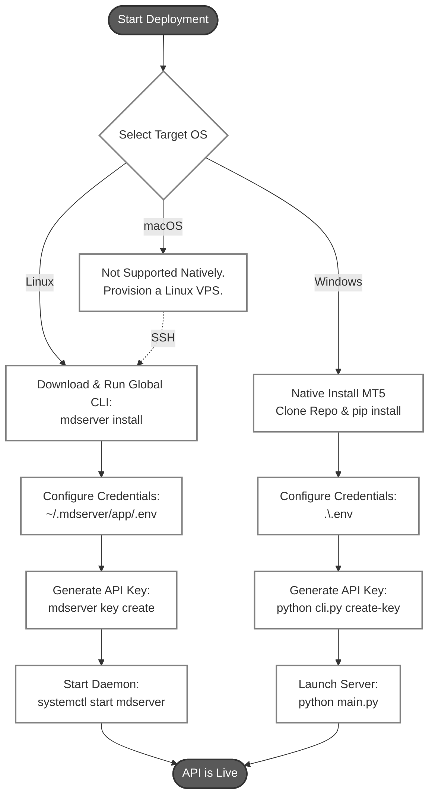

# MDServer: The Headless REST API Engine for MetaTrader 5

[](LICENSE)
[](https://www.python.org/downloads/release/python-31011/)


Quantitative analysts, machine learning researchers, and algorithmic traders require reliable, programmatic access to global markets. While MetaTrader 5 provides unparalleled broker connectivity, it is fundamentally a restrictive, Windows-only GUI application. Its walled-garden C++ architecture and proprietary anti-tamper protections make deploying algorithms on Linux servers or headless cloud environments notoriously unstable.

MDServer engineers around these structural limitations. It transforms MT5 into an OS-agnostic, institutional-grade microservice.

*(MDServer also serves as the standalone backend engine powering MarketDash Pro: an AI-powered terminal utility for quantitative analysis and algorithmic execution).*

## Table of Contents

* [The Engineering Philosophy](#the-engineering-philosophy)
  * [Timezone Anchoring (`Europe/Athens`)](#timezone-anchoring-europeathens)
* [Built for the Modern Desk](#built-for-the-modern-desk)
* [Architecture & Security](#architecture--security)
* [🚀 Quick Start (Linux)](#-quick-start-linux)
  * [1. Install the CLI & Provision the Engine](#1-install-the-cli--provision-the-engine)
    * [🛑 Mandatory One-Time VNC Setup](#-mandatory-one-time-vnc-setup)
  * [2. Configure MT5 Broker Credentials](#2-configure-mt5-broker-credentials)
  * [3. Generate Security Token](#3-generate-security-token)
  * [4. Enable the Daemon](#4-enable-the-daemon)
  * [5. Verify the API](#5-verify-the-api)
  * [6. Visual Verification (Optional)](#6-visual-verification-optional)
* [Deployment Architectures](#deployment-architectures)
  * [🐧 Linux (Local Desktop or Remote VPS)](#-linux-local-desktop-or-remote-vps)
  * [🪟 Windows (Native)](#-windows-native)
  * [🍏 macOS](#-macos)
* [MDServer Management Tool (CLI)](#mdserver-management-tool-cli)
* [Core API Reference](#core-api-reference)
  * [System & Metadata](#system--metadata)
  * [Market Data](#market-data)
  * [Trade Execution](#trade-execution)
* [Troubleshooting & Q&A](#troubleshooting--qa)
* [⚖️ Legal & Disclaimer](#legal--disclaimer)

---

## The Engineering Philosophy

MDServer was designed with a singular focus: absolute stability in headless environments. Rather than attempting to bypass MT5's core architecture, MDServer encapsulates a sterile, version-locked installation inside a deterministic WINE 10 container.

* **Headless Lifecycle Management:** By routing MT5's forced graphical rendering through a sterile, in-memory virtual framebuffer (`Xvfb`), the terminal boots flawlessly without a physical monitor. Wrapped as a native `systemd` daemon, the engine ensures a persistent, always-up lifecycle that effortlessly survives server reboots and network drops.
* **Ultra-Low Latency Execution:** Because the Python FastAPI layer and the MT5 engine share the exact same local memory space within the container, data serialization and trade routing occur with near-zero latency, circumventing the delays typical of external network bridges.

### Timezone Anchoring (`Europe/Athens`)

MDServer strictly anchors all historical and live price action queries to `Europe/Athens` (EET/EEST) before standardizing to UTC. This aligns the 00:00 midnight rollover perfectly with the 17:00 EST New York market close, permanently eliminating the "Sunday Candle" data corruption issue. This standardization strictly mirrors the native server time configuration used by over 90% of top-tier global brokers.

---

## Built for the Modern Desk

By exposing the underlying MT5 data bridge via a Zero-Trust REST API, MDServer allows different roles within a trading firm to utilize standard web protocols instead of writing fragile MQL5 scripts.

* **Algorithmic Traders:** Deploy complex Python ML pipelines (PyTorch, Scikit-learn, Pandas) directly on a remote Linux server, executing trades via simple JSON payloads.
* **Quantitative Strategists:** Extract massive, uncorrupted historical tick and OHLCV datasets for deterministic backtesting without terminal freezes.
* **Risk Managers:** Monitor global account exposure, margin utilization, and floating PnL in real-time across multiple strategies via a unified endpoint.
* **Portfolio Managers:** Aggregate cross-asset positions, review macro exposures, and balance portfolio allocations seamlessly using standard REST queries.
* **Data Engineers:** Route Level 2 Depth of Market (DOM) snapshots and live ticks into proprietary databases or WebSocket streams for institutional dashboarding.
* **DevOps Engineers:** Deploy headless MT5 environments predictably using standard CI/CD pipelines and systemd orchestration without wrangling Windows Server licenses.

---

## Architecture & Security

MDServer operates on a **Zero-Trust security model**. It has no default passwords. Every request to the API must include a valid cryptographic Bearer Token in the HTTP headers.



---

## 🚀 Quick Start (Linux)

> 💡 **Deployment Note:** Please read this guide carefully. While there are strict details regarding case-sensitivity and network credentials, following these steps exactly will result in a fully operational, headless MT5 REST API in under **5 minutes**. The WINE configuration and network caching is a strictly **one-time setup**.

For Ubuntu, Debian, and Fedora, MDServer uses a global CLI tool to provision a stateless WINE Golden Image containing a sterile MT5 installation and your application code.

### 1. Install the CLI & Provision the Engine

Download the deployment wrapper and move it to your system's execution path. This handles OS detection, version-locks WINE 10, downloads the engine, and clones this repository.

```bash
wget -O mdserver https://raw.githubusercontent.com/codalumina/mdserver/main/mdserver
chmod +x mdserver
sudo mv mdserver /usr/local/bin/
mdserver install
```

#### 🛑 Mandatory One-Time VNC Setup

During installation, the script will pause and prompt you to perform a one-time visual login. Because a raw MT5 installation only knows about the default MetaQuotes demo servers, you must manually search for your specific broker inside the GUI once to cache the network routing data. The script will automatically launch a VNC server on port `5900` for this purpose.

**How to connect to the VNC Server (Password: `setup`):**

* **If installing remotely (on a VPS):**
*(Note: Ensure port 5900 is temporarily open on your VPS firewall).*

* **macOS (Native):** Open Safari (or Finder -> Go -> Connect to Server), type `vnc://<YOUR_VPS_IP>:5900` in the address bar, and press Enter. The built-in Screen Sharing app will launch. When prompted, enter the password `setup`.
* **Windows (Requires Installation):** Download a free VNC client like [RealVNC Viewer](https://www.realvnc.com/en/connect/download/viewer/) or [TightVNC](https://www.tightvnc.com/). Open the client and connect to `<YOUR_VPS_IP>:5900`. When prompted, enter the password `setup`.
* **Linux (Requires Installation):** Install a VNC client using your package manager (e.g., `sudo apt install remmina` or `sudo dnf install remmina`). Open the client and connect to `<YOUR_VPS_IP>:5900`. When prompted, enter the password `setup`.

**What to do once connected to the MT5 screen:**

1. Close any initial Welcome or EULA popups. **⚠️ IF AN UPDATE POPUP APPEARS, CLICK 'LATER' OR 'CANCEL'. DO NOT UPDATE.** Updating will overwrite the locked pristine environment and force a re-installation.
2. Go to **File -> Open an Account**.
3. Type your broker's name in the search bar and click **"Find your broker"**.
4. Select your broker from the list and click Next.
5. Select **"Connect with an existing trade account"**.
6. Enter your Login, Password, and select the correct Server from the dropdown. **Ensure "Save password" is checked.**
7. Click Finish to log in.
8. Go to **Tools -> Options -> Expert Advisors** (or press `Ctrl+O`) and check the box for **"Allow algorithmic trading"**.
9. Verify you hear the login chime and see live data ticking in the Market Watch panel.
10. Go back to your original SSH terminal and press **[ENTER]** to allow the script to clean up the VNC session and finish generating the background systemd daemon.

### 2. Configure MT5 Broker Credentials

The API handles MT5 logins automatically in the background. Your credentials are fundamentally secure: they are stored exclusively in a local, unversioned `.env` file on your own machine or VPS. They are never transmitted to any external third-party servers. When the daemon starts, the Python bridge reads this local file and injects your login details directly into the MT5 terminal's memory to establish the broker connection.

Navigate to your newly cloned application directory and enter your broker credentials:

```bash
cd ~/.mdserver/app
nano .env
```

Add your details:

```ini
MT5_LOGIN=12345678
MT5_PASSWORD=YourBrokerPassword
MT5_SERVER=YourBroker-LiveServer
```

⚠️ **CRITICAL TIMEOUT WARNING:** The `MT5_SERVER` variable must match the exact, case-sensitive spelling of the server as it appears in your broker's terminal (e.g., `PepperstoneUK-Demo`). Be careful as any typo here will cause the API bridge to silently hang and fail to boot.

### 3. Generate Security Token

Generate your master API key to authenticate external requests. **Save this key immediately. You will not see this key in full ever again. You can, however, revoke this and issue a new key if you lose it.**

```bash
mdserver key create "Admin"
```

### 4. Enable the Daemon

Start the Systemd service to ensure MDServer runs 24/7 and survives server reboots.

```bash
sudo systemctl enable mdserver --now
```

Your API is now live and translating MT5 data.

* If running locally, connect to `http://127.0.0.1:14234/marketserver/api`.
* If running remotely, connect to `http://<YOUR_VPS_IP>:14234/marketserver/api`.

*(Note: To pull future API updates without re-downloading the heavy WINE container, simply run `mdserver update`)*.

### 5. Verify the API

To confirm that MDServer is running and successfully communicating with your broker, ping the `/stat/` endpoint using your new API key:

```bash
curl -H "Authorization: Bearer <YOUR_API_KEY>" [http://127.0.0.1:14234/marketserver/api/stat/](http://127.0.0.1:14234/marketserver/api/stat/)
```

If successful, you will receive a JSON response containing your MT5 connection status, terminal build, and hardware metrics.

If running remotely, replace `127.0.0.1` with your `<YOUR_VPS_IP>`.

### 6. Visual Verification (Optional)

MDServer runs 100% headlessly in the background. However, if you want to visually verify that your algorithmic trades are executing correctly on the chart, you can attach a VNC viewer to the live background process at any time:

```bash
mdserver view
```

This will expose the active virtual display on port 5900 (or 5901). Connect your VNC client using the password `view`. When you are done monitoring, simply press CTRL+C in your SSH terminal. This closes the VNC server but leaves MT5 and your API running seamlessly in the background.

> **💡 Pro Tip: Independent Local Monitoring**
> You only need to use VNC (`mdserver view`) when configuring the MDServer instance or debugging backend terminal settings. For everyday monitoring, you do not need to remote into the VPS. Because MetaTrader supports concurrent logins, you can simply install a standard MT5 application on your personal Mac, Windows PC, or mobile phone and log into the exact same broker account. You will be able to watch your MDServer algorithms execute trades in real-time from your own device.

---

## Deployment Architectures

Because the underlying MT5 Python library is strictly compiled for Windows by MetaQuotes, deployment strategies vary by operating system.



### 🐧 Linux (Local Desktop or Remote VPS)

The recommended deployment path.

* **Automated Provisioning:** You do not need to clone the repository or install X11 dependencies manually. The `mdserver install` command handles OS detection, fetches the Golden Image into `~/.mdserver/`, clones the application into `~/.mdserver/app/`, and installs necessary framebuffer packages (`xvfb`, `x11vnc`).
* **One-Time Network Caching:** During the initial installation, the script pauses and launches a temporary VNC server. This allows you to perform a mandatory one-time manual login to your broker via the GUI, which caches the broker's specific network topology into the sterile environment.
* **Headless Execution:** Once the topology is cached, the Python backend handles all future broker logins and data routing autonomously using your `.env` credentials. The script automatically generates a `systemd` service that wraps MT5 in a virtual framebuffer (`Xvfb`), satisfying graphical rendering entirely in memory without a desktop environment.

**Optional: Visual Debugging via VNC**
If you need to visually verify the terminal state or live algorithmic execution for debugging, you do not need to configure display ports manually. Simply run:

```bash
mdserver view
```

This securely attaches a VNC server to the active in-memory display.(If running on a remote VPS, you can securely tunnel into your server via SSH (`ssh -L 5900:localhost:5900 user@<YOUR_VPS_IP>`) and point your local VNC client to `localhost:5900` with the password `view`).

### 🪟 Windows (Native)

Because MetaTrader 5 is a native Windows application, you do not need the WINE container, virtual framebuffers, or complex deployment wrappers. You can run the Python REST API natively alongside your standard MT5 terminal using `uv` for a lightning-fast, cleanly isolated virtual environment.

* **Prerequisites:** Git installed on your system. You do **not** need to install Python manually—we will use `uv` to handle it automatically.

**Execution:**

1. **Install MT5:** Download and install MetaTrader 5 directly from your broker. Open it, log into your account, check **"Save password"**, and go to **Tools -> Options -> Expert Advisors** to check **"Allow algorithmic trading"**.
2. **Install `uv` (The Package Manager):** Open PowerShell and run the official standalone installer:

    ```powershell
    powershell -ExecutionPolicy ByPass -c "irm [https://astral.sh/uv/install.ps1](https://astral.sh/uv/install.ps1) | iex"
    ```

    *⚠️ **Important:** Close your PowerShell window and open a new one so the new `uv` command is recognized by your system.*

3. **Clone the Repository:** In your new PowerShell window:

    ```powershell
    git clone https://github.com/codalumina/mdserver.git C:\mdserver
    cd C:\mdserver
    ```

4. **Provision Python 3.10 & Install Dependencies:** Use `uv` to download Python 3.10, create an isolated virtual environment, and install the required packages instantly.

    ```powershell
    uv python install 3.10
    uv venv --python 3.10
    uv pip install -r requirements.txt
    ```

5. **Configure Credentials & Path:**
   Copy `.env.example` to `.env` (or create a new `.env` file). Enter your exact MT5 Login, Password, and Server strings, and **verify that the `TERMINAL_PATH` variable correctly points to your native Windows MT5 executable** (e.g., `TERMINAL_PATH="C:\Program Files\MetaTrader 5\terminal64.exe"`).

6. **Generate API Key:**

    ```powershell
    uv run python cli.py create-key --client "Admin"
    ```

7. **Create Launcher & Start Server:**
    Generate a simple batch file to easily launch your API in the future, then boot the server:

    ```powershell
    echo uv run python main.py > start.bat
    .\start.bat
    ```

8. **Verify the API:**
    Open a new PowerShell window (keeping the server running in the original) and ping the status endpoint using your new API key:

    ```powershell
    curl.exe -H "Authorization: Bearer <YOUR_API_KEY>" [http://127.0.0.1:14234/marketserver/api/stat/](http://127.0.0.1:14234/marketserver/api/stat/)
    ```

    If successful, you will receive a JSON response containing your live MT5 connection status and hardware metrics.

### 🍏 macOS

MDServer cannot run natively on macOS (Apple Silicon or Intel).

* **Execution:** You must deploy MDServer on a cheap Linux VPS (e.g., DigitalOcean, AWS) using the Linux CLI instructions above. You can then run your local Python algorithms or UI on your Mac, fetching data from the VPS remotely via your Zero-Trust Bearer Token.

---

## MDServer Management Tool (CLI)

On Linux deployments, the global `mdserver` wrapper acts as your centralized management tool for the entire application lifecycle.

| Command | Action | Description |
| :--- | :--- | :--- |
| `mdserver` | `install` | Provisions the WINE 10 engine, configures Xvfb, and clones the application. |
| `mdserver` | `update` | Pulls the latest codebase from GitHub, updates dependencies, and restarts the daemon. |
| `mdserver` | `start` | Boots the background systemd server daemon. |
| `mdserver` | `stop` | Safely terminates the background systemd server daemon. |
| `mdserver` | `status` | Displays daemon uptime, systemd logs, and active WINE memory states. |
| `mdserver` | `view` | Attaches a VNC server to the in-memory display for visual debugging (Port 5900). |
| `mdserver` | `version` | Displays the current versions of the Golden Image engine and the local Git application. |
| `mdserver` | `key create "Name"` | Generates a new Zero-Trust Bearer Token for API authentication. |
| `mdserver` | `key list` | Lists all active API keys and their respective IDs. |
| `mdserver` | `key revoke <ID>` | Permanently revokes a specific API key by its ID. |

---

## Core API Reference

All endpoints require the header: `Authorization: Bearer <YOUR_KEY>`

### System & Metadata

| Method | Endpoint | Description |
| --- | --- | --- |
| **GET** | `/stat/` | Hardware metrics, daemon uptime, and MT5 connection status. |
| **GET** | `/symbols/all/` | Comprehensive metadata (tick size, volume steps) for all assets. |

#### Market Data

| Method | Endpoint | Description | Query Parameters |
| --- | --- | --- | --- |
| **GET** | `/recent/` | Fetches recent OHLCV price action. | `?symbol=EURUSD&timeframe=H1&count=100` |
| **GET** | `/historical/` | Strict date-range historical fetch. | `?symbol=XAUUSD&timeframe=D1&start_date=...` |
| **GET** | `/book/` | Retrieves Level 2 Depth of Market (DOM) snapshot. | `?symbol=EURUSD` |

#### Trade Execution

| Method | Endpoint | Description | JSON Payload Schema |
| --- | --- | --- | --- |
| **GET** | `/trade/positions/` | Lists all active positions. | *(None)* |
| **POST** | `/trade/execute/` | Opens a market or pending order. | `{"symbol": "EURUSD", "volume": 1.0, "type": "BUY"}` |
| **POST** | `/trade/close/` | Closes an open position by ticket ID. | `{"ticket": 12345678}` |

---

## Troubleshooting & Q&A

**Q: The API spins and times out indefinitely. No data routes.**
**A:** This is almost always caused by a typo in the `~/.mdserver/app/.env` file. The `MT5_SERVER` variable must match the exact, case-sensitive string provided by your broker (e.g., `PepperstoneUK-Demo`). If it is off by a single character, MT5 will infinitely search for a non-existent network topology.

**Q: I accidentally clicked "Update" during the VNC setup phase, and now MT5 won't boot.**
**A:** The update overwrote the locked, pristine WINE environment. You must perform a clean wipe. Stop the daemon, run the scorched-earth cleanup, and reinstall:

```bash
sudo killall -9 Xvfb x11vnc wine wineserver winedevice.exe python python3 2>/dev/null || true
rm -rf ~/.mdserver
mdserver install
```

**Q: `mdserver view` fails with "Authorization required" or Xauthority errors.**
**A:** This occurs if you attempt to view the stream from a different Linux user account than the one that installed the daemon. Always run `mdserver view` as the user that owns the `~/.mdserver` directory so the script can dynamically parse the randomized `/tmp/` security cookie.

**Q: My trades are being rejected with "AutoTrading disabled by client".**
**A:** You forgot to enable algorithmic trading during the VNC setup phase. Run `mdserver view`, press `Ctrl+O` in the terminal, navigate to the Expert Advisors tab, and check the box for "Allow algorithmic trading".

---

## Legal & Disclaimer

**MDServer is an open-source infrastructure tool provided strictly for educational, research, and development purposes.**

* **Not Affiliated:** "MetaTrader 5" is a registered trademark of MetaQuotes Ltd. This project is an unofficial, community-driven wrapper and is not affiliated with, endorsed by, or associated with MetaQuotes Ltd. in any capacity.
* **High Risk:** Algorithmic trading in financial markets involves a high degree of risk. The authors shall not be held liable for any financial losses, missed opportunities, software bugs, or broker account suspensions resulting from the use of MDServer.

By downloading and deploying this software, you explicitly agree to the terms outlined in the **[MIT License](LICENSE)** and acknowledge the full **[Disclaimer of Liability](DISCLAIMER.md)**.
